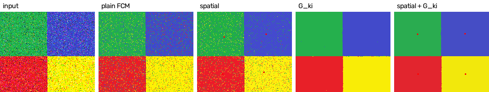
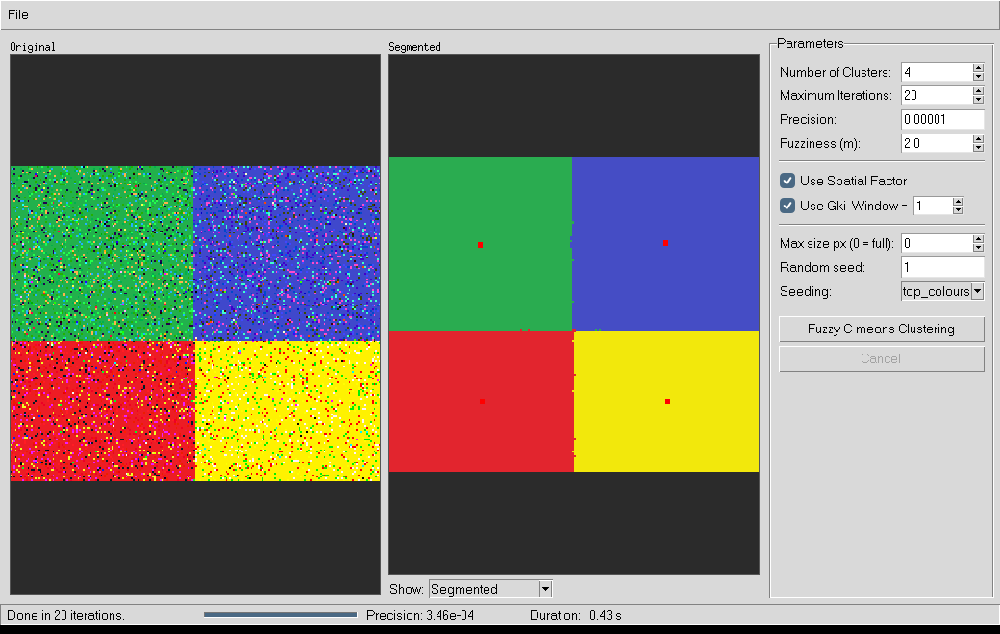

# fcm-gki — Modified Fuzzy C-Means image segmentation for Python

A Python library, command-line tool and desktop GUI implementing the **Modified Fuzzy C-Means
Clustering Algorithm with Spatial Distance to Cluster Center of Gravity** (IEEE ISM 2010), with
the **G<sub>ki</sub> fuzzy local neighbourhood factor**. It is a port of the C# project
[FuzzyCMeansClusteringGKI](https://github.com/Christophe-Gauge/FuzzyCMeansClustering/tree/main/FuzzyCMeansClusteringGKI),
with the orientation and algorithm bugs of the original fixed.

The core is pure NumPy and takes images exactly as OpenCV gives them, so it drops straight into
an OpenCV pipeline.



## Features

- **OpenCV-native:** accepts `cv2.imread` arrays (BGR `uint8`), greyscale, or any colour space
  such as Lab or HSV. Outputs keep the input's channel order.
- **Two APIs:** an object API (`ModifiedFCM`) and a `cv2.kmeans`-style function (`fuzzy_cmeans`)
  that takes the same `criteria` tuples.
- **Fuzzy output:** per-cluster membership maps (`float32`) usable as soft masks, plus hard
  labels and `uint8` masks.
- **The paper's modifications**, each switchable: the spatial centre-of-gravity penalty and the
  G<sub>ki</sub> neighbourhood factor with a configurable window.
- **Vectorised NumPy**, with no per-pixel Python loops.
- **CLI and Tkinter GUI** modelled on the original app, with live preview and cancel.

## Installation

```bash
pip install .                 # core library, NumPy only
pip install ".[io]"           # + Pillow, for the CLI and fcm_gki.io
pip install ".[gui]"          # + Pillow, for the GUI
pip install ".[opencv,test]"  # + OpenCV and pytest, for the examples and tests
```

The GUI needs Tkinter. It ships with the python.org installers for Windows and macOS; on
Debian/Ubuntu run `sudo apt install python3-tk`.

## Quick start

### With OpenCV

```python
import cv2
import fcm_gki

img = cv2.imread("photo.jpg")                         # BGR uint8
res = fcm_gki.ModifiedFCM(n_clusters=4, use_spatial=True, use_gki=True).fit(img)

cv2.imwrite("segmented.png", fcm_gki.render_segmented(res))
mask = res.mask(0)                 # uint8 0/255 mask of cluster 0
soft = res.membership(0)           # float32 fuzzy membership of cluster 0
```

### `cv2.kmeans` style

```python
criteria = (cv2.TERM_CRITERIA_EPS + cv2.TERM_CRITERIA_MAX_ITER, 20, 1e-5)
compactness, labels, centers, res = fcm_gki.fuzzy_cmeans(img, 4, criteria, use_gki=True)
segmented = centers[labels.ravel()].reshape(img.shape).astype("uint8")
```

### Command line

```bash
fcm-gki image.png -c 5 --spatial --gki -w 1 -o out/
```

This writes `segmented.png` and `Cluster0.png … ClusterN.png` (original pixels per cluster on
black), like the C# app. Run `fcm-gki -h` for all options.

### GUI

```bash
fcm-gki-gui [image]          # or: python -m fcm_gki.gui
```



The GUI has the same controls as the original: number of clusters, maximum iterations,
precision, *Use Spatial Factor* and *Use Gki Window =*. It adds fuzziness, a seed, the seeding
method and optional downscaling. While a run is going, the segmentation updates every
iteration and **Cancel** stops it. When it finishes, the *Show* menu lets you view each
cluster, and **File ▸ Save Results** writes all the images.

## Parameters at a glance

| Parameter | Default | Meaning |
|---|---|---|
| `n_clusters` | 5 | number of clusters K |
| `fuzziness` | 2.0 | fuzzifier m (> 1); higher means softer memberships |
| `use_spatial` | False | penalise membership by distance to each cluster's centre of gravity |
| `use_gki` | False | add the G<sub>ki</sub> neighbourhood factor (noise robustness) |
| `window` | 1 | G<sub>ki</sub> neighbourhood radius (1 → 3×3, 2 → 5×5) |
| `max_iter` / `tol` | 20 / 1e-5 | stop at max iterations or when max \|ΔU\| < tol |
| `init` | `"top_colours"` | `"top_colours"`, `"kmeans++"`, `"random"` or a (K, C) array |
| `seed` | None | random seed for reproducible runs |

All parameters are described in [docs/api.md](docs/api.md).

## Results

Pixel accuracy against the clean ground truth on the repository's test images (4 clusters,
seed 1):

| Mode | low noise | high noise |
|---|---|---|
| Plain FCM | 95.7 % | 87.6 % |
| Spatial | 97.1 % | 92.0 % |
| G<sub>ki</sub> | 100 % | 99.8 % |
| Spatial + G<sub>ki</sub> | 100 % | 99.9 % |

Speed is about 0.5 s per iteration for plain FCM on a 1-megapixel image with 5 clusters, and
about 0.9 s with both modifications on (2-core machine). For big photos, downscale with
`--max-dim` or `cv2.resize` first.

## Documentation

- [docs/algorithm.md](docs/algorithm.md): the maths of FCM, the spatial term and G<sub>ki</sub>.
- [docs/api.md](docs/api.md): API reference.
- [docs/opencv.md](docs/opencv.md): OpenCV integration recipes and the path to a native
  OpenCV module.
- [docs/porting-notes.md](docs/porting-notes.md): what changed from the C# code and why,
  including the rotation fix.
- [examples/opencv_example.py](examples/opencv_example.py): a runnable OpenCV example.

## Tests

```bash
pip install ".[test,opencv]"
pytest
```

The OpenCV tests are skipped automatically if `cv2` isn't installed.

## Project layout

```
src/fcm_gki/
  core.py   algorithm and rendering (NumPy only)
  io.py     Pillow-based load/save with EXIF orientation
  cli.py    fcm-gki command
  gui.py    fcm-gki-gui Tkinter app
tests/      pytest suite (core + OpenCV round-trips)
examples/   OpenCV example and the original test images
docs/       documentation
```

## References

- "Modified Fuzzy C-Means Clustering Algorithm with Spatial Distance to
  Cluster Center of Gravity", *6th IEEE International Workshop on Multimedia Information
  Processing and Retrieval*, 2010.
  [doi:10.1109/ISM.2010.53](https://dx.doi.org/10.1109/ISM.2010.53)
- "Automated Colorization of Grayscale Images Using Texture Descriptors and
  a Modified Fuzzy C-Means Clustering", *JILSA* 4(2), 2012.
  [doi:10.4236/jilsa.2012.42013](http://dx.doi.org/10.4236/jilsa.2012.42013)
- S. Krinidis, V. Chatzis, "A Robust Fuzzy Local Information C-Means Clustering Algorithm",
  *IEEE Trans. Image Processing* 19(5), 2010 (origin of the G<sub>ki</sub> factor).

## License

GNU GPL v3, the same `LICENSE` file as the original repository. That repository's README badge
says LGPL v3; if LGPL was the intent, replace `LICENSE` and the `license` field in
`pyproject.toml` together.
